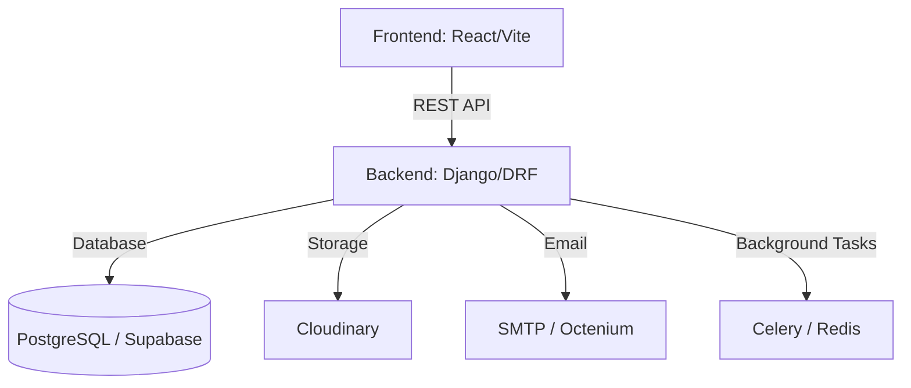

# 🌍 Kleer Infini: The Premium B2B Gateway for Algerian Export

[](https://www.kleerinfini.dz)
[](https://kleerinfini-backend.onrender.com/swagger/)
[](#-tech-stack)

**Kleer Infini** is a high-performance B2B platform designed to facilitate the exportation of Algerian excellence worldwide. Built with a focus on scalability, security, and premium user experience, it connects local producers with global buyers through a sophisticated digital ecosystem.

---

## 🏗️ Project Architecture

This is a full-stack monorepo (monolithic repository) architecture designed for streamlined deployment and consistency.



### 📁 Structure
- **[/kleerinfini-ui](file:///c:/Users/DELL/Desktop/dev/kleerinfini-b2b-platform/kleerinfini-ui)**: Premium React frontend with Tailwind CSS and Framer Motion.
- **[/kleer-infini-backend](file:///c:/Users/DELL/Desktop/dev/kleer-infini-backend)**: Robust Django REST Framework API with secure authentication (JWT) and OCR integration.

---

## 🚀 Tech Stack

### Frontend
- **Framework**: React 18 (Vite)
- **Styling**: Tailwind CSS + Custom Design System
- **Animations**: Framer Motion
- **State Management**: Context API / Hooks
- **Internationalization**: i18next (FR, EN, AR, ES)

### Backend
- **Framework**: Django 5.x + Django REST Framework
- **Authentication**: JWT (SimpleJWT)
- **Database**: PostgreSQL (Supabase)
- **Asynchronous Tasks**: Celery + Redis
- **Security**: CORS, CSRF, Secure SSL Redirection

### Infrastructure & DevOps
- **Deployment**: Render (Infrastructure as Code via `render.yaml`)
- **Containerization**: Docker (Local & Staging)
- **Domain & Mailing**: Octenium

---

## 🌟 Key Features (Senior Showcase)

- **Dynamic Producer Dashboard**: Real-time analytics and management for producers.
- **OCR Invoice Scanner**: Integrated backend logic to read and validate PDFs (in progress).
- **Multi-lingual SEO Architecture**: Optimized indexing for global search visibility.
- **Responsive Premium Design**: Mobile-first approach with high-end aesthetics.

---

## 🛠️ Getting Started

### Prerequisites
- Node.js (v20+)
- Python (v3.10+)
- Docker (optional)

### Installation
1. Clone the repository:
   ```bash
   git clone https://github.com/kenza-oss/projet.git
   ```
2. Setup Frontend:
   ```bash
   cd kleerinfini-b2b-platform/kleerinfini-ui
   npm install
   npm run dev
   ```
3. Setup Backend:
   ```bash
   cd kleer-infini-backend/kleerinfini
   pip install -r requirements.txt
   python manage.py runserver
   ```

---

<p align="center">
  Developed with ❤️ by <b>Kenza</b> - Senior Full-Stack Mobile Engineer
</p>
